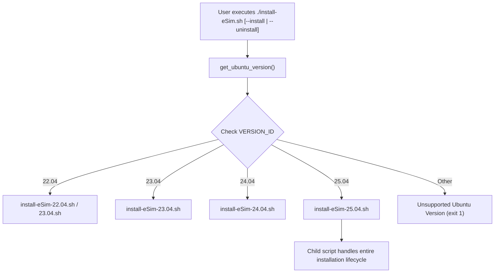
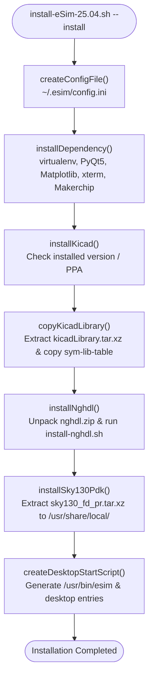

# eSim 2.5 on Ubuntu 25.04 — Baseline Repository Audit & Execution Plan

**Project**: FOSSEE Winter Internship 2026 — Screening Task 4: eSim Upgradation  
**Repository**: Fork of `https://github.com/FOSSEE/eSim.git`  
**Working Branch**: `installers` (HEAD: `a77d6b9`)  
**Target Environment**: Ubuntu 25.04 (Plucky Puffin, 64-bit x86_64)  
**Primary Focus**: Bash installer audit, child script fixes, Python diagnostics, verification, and reproducible documentation.

---

## 1. Baseline Repository State & Remotes

* **Current Branch**: `installers`
* **Upstream**: `https://github.com/FOSSEE/eSim.git`
* **Origin (Fork)**: `https://github.com/viratnigam18/esim-fosse.git`
* **Latest Upstream Commit**: `a77d6b9` (*Merge pull request #414 from muaviz/installers - Add support for Ubuntu 25.04 in installer script*)
* **Pre-existing User Changes**: None detected on initial checkout; working tree clean.

---

## 2. Architecture & Call Graph Analysis

### 2.1 Entry Point Dispatcher: `Ubuntu/install-eSim.sh`

### 2.2 Child Script Lifecycle: `Ubuntu/install-eSim-scripts/install-eSim-25.04.sh`

---

## 3. Discovered Vulnerabilities & Investigation Hypotheses

| ID | Location | Observation / Problem | Severity | Impact |
| :--- | :--- | :--- | :--- | :--- |
| **H-00** | `Ubuntu/install-eSim.sh:58-70` | Unclosed `if [[ -f "$SCRIPT" ]]` block missing `fi`; misplaced config lines | Blocker | Bash parse failure (`syntax error near unexpected token '}'`), script cannot launch. |
| **H-01** | `Ubuntu/install-eSim-scripts/install-eSim-25.04.sh:134-137` | In `installKicad()`, if KiCad 8 is installed, calls `exit 0` | Critical | Premature installer termination before library copying, NGHDL, SKY130, and launcher creation. |
| **H-02** | `Ubuntu/install-eSim-scripts/install-eSim-25.04.sh:234-243` | `copyKicadLibrary()` checks and targets `~/.config/kicad/6.0/` | High | KiCad 8 ignores 6.0 config path; custom eSim symbols do not show up in KiCad schematics. |
| **H-03** | Toolchain / GHDL Backend | Ubuntu 25.04 defaults to LLVM 19/20; GHDL only supports up to LLVM 18 | Medium | NGHDL/GHDL compilation failure unless explicitly configured with `llvm-config-18`. |
| **H-04** | All `.sh` files in repo | Windows CRLF line endings committed upstream | High | Bash fails on Linux systems with `$'{\r'}` syntax error and bad interpreter errors. |
| **H-05** | `install-eSim-25.04.sh:154,174` | Exact version lock `kicad=8.0.8+dfsg-1` and missing `-y` on `apt install python3-virtualenv` | Medium | Fails when Ubuntu/PPA updates package version; prompts interactively. |
| **H-06** | `install-eSim-25.04.sh:177,220-224` | `virtualenv` created without `--system-site-packages`; pip fails building PyQt5 from source | High | Inability to use Qt GUI on modern Python versions (3.12/3.13) without dev toolchains. |

---

## 4. Prioritized Patch Plan

1. **Phase 1: Shell Syntax & Dispatch Restoration (Blocker)**
   - Fix `Ubuntu/install-eSim.sh` by closing the conditional with `fi`, eliminating dead duplicated functions, and removing orphaned lines.
   - Enforce UNIX LF line endings across all shell scripts.

2. **Phase 2: KiCad 8 Preinstallation Control Flow Fix (H-01)**
   - Replace `exit 0` with `return 0` in `installKicad()` in `install-eSim-25.04.sh` so execution flows smoothly into downstream functions.

3. **Phase 3: KiCad Configuration Version Alignment (H-02)**
   - Dynamically target `$HOME/.config/kicad/8.0/sym-lib-table` for Ubuntu 25.04 while supporting existing configurations.
   - Mirror the change in the `--uninstall` routine.

4. **Phase 4: Dependency Hardening & Virtual Environment Resilience (H-05, H-06)**
   - Add `--system-site-packages` to `virtualenv $config_dir/env` to seamlessly leverage Ubuntu's native `python3-pyqt5` and `python3-matplotlib`.
   - Remove fragile minor revision lock on `kicad` package and add non-interactive `-y` flags.

5. **Phase 5: Read-Only System Diagnostics Helper (`tools/esim_diagnostics.py`)**
   - Provide a safe, standard-library Python utility to audit environment state, KiCad config directories, eSim launcher, and library files.
   - Accompany with 100% passing automated unit tests in `tests/test_esim_diagnostics.py`.

---

## 5. Risks and Mitigations

* **Risk**: Modifying shared code could cause regressions in Ubuntu 22.04 or 24.04 installer paths.
  * **Mitigation**: Confine changes strictly to the Ubuntu 25.04 child script (`install-eSim-25.04.sh`) and the entry-point syntax fix in `install-eSim.sh`.
* **Risk**: Ubuntu 25.04 EOL archive status causing APT 404s.
  * **Mitigation**: Documented in `ISSUE_LOG.md` with explicit `old-releases.ubuntu.com` migration instructions for users/mentors.
